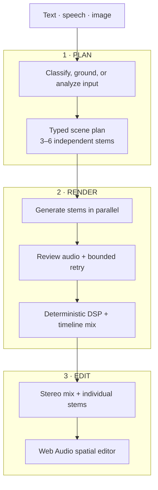

# SoundScene

SoundScene converts a text description, spoken prompt, or still image into an editable spatial audio scene. Instead of generating one opaque audio clip, it plans a scene as three to six independent sound stems, renders them concurrently, applies deterministic audio processing, and exposes each stem in a browser-based editor.

The project explores a practical systems question: how can probabilistic multimodal models produce an output that remains structured, inspectable, and directly manipulable by a user?

**[Open the interactive demo](https://auxscene.vercel.app/)** — explore a pre-rendered scene and manipulate its individual sound sources in the spatial editor.

## At a glance

| | |
|---|---|
| **Core challenge** | Convert probabilistic multimodal output into a structured, editable audio system |
| **Pipeline** | Gemini scene planning → bounded parallel ElevenLabs generation → deterministic DSP → Web Audio editing |
| **Output** | A stereo mix plus three to six independently editable stems |
| **Inspectable evidence** | Typed plans, bounded concurrency, explicit retry/cache policy, and deterministic DSP stages |
| **Stack** | FastAPI, Pydantic, NumPy/SciPy/Pedalboard, React, TypeScript, Web Audio API |
| **Live demo** | [auxscene.vercel.app](https://auxscene.vercel.app/) |

## System overview

SoundScene separates scene creation into three layers:

1. **Planning:** Gemini classifies and grounds the input, then produces a typed audio plan with sound sources, positions, acoustic properties, and mix metadata.
2. **Rendering:** ElevenLabs generates each stem. The backend validates, reviews, conditions, spatializes, and mixes the results into a stereo WAV.
3. **Interaction:** The React client loads individual stems into separate Web Audio graphs so users can reposition, mute, solo, adjust, regenerate, and export them.



## Engineering highlights

### Typed boundary between models and execution

Model output is parsed into Pydantic schemas before it enters the rendering pipeline. Each sound element carries:

- a concrete generation prompt and short display label;
- normalized `x`, `y`, and reverb values;
- foreground, midground, or background placement;
- generation settings such as duration, looping, and prompt influence;
- timeline and mix settings such as start time, target level, filters, fades, and background ducking.

Invalid or incomplete model output is rejected or replaced by deterministic layer-based defaults. This keeps the downstream audio pipeline independent of free-form model responses.

### Bounded asynchronous orchestration

Stem generation is I/O-bound, so the FastAPI backend creates one asynchronous render task per element while limiting simultaneous ElevenLabs requests with an `asyncio.Semaphore`. Scene-image generation runs in parallel with the audio path. Provider rate limits receive bounded retries that honor `Retry-After` when available.

The cache uses an exact key over the prompt and generation settings, followed by a constrained token-overlap lookup for near-duplicate prompts. When automated review is enabled, cache writes are deferred until the review-and-retry path finishes, and near-silent outputs are never stored.

### Deterministic audio pipeline

Generated 16-bit PCM is converted to floating-point samples and processed with NumPy, SciPy, and Pedalboard:

1. trim or pad to the planned duration;
2. resample from 24 kHz to 44.1 kHz;
3. apply high-pass and low-pass filtering, fades, RMS conditioning, and peak control;
4. derive distance attenuation and filtering from depth;
5. apply reverb and equal-power stereo panning;
6. position stems on a timeline and duck background beds under foreground events;
7. apply final headroom and soft limiting before WAV export.

This is **2D stereo spatialization**, not HRTF-based binaural rendering. The distinction is deliberate: the current implementation favors a portable, explainable signal path over a more complex three-dimensional acoustic model.

### Per-stem quality controls

The renderer detects near-silent PCM before it is accepted. An optional Gemini audio reviewer compares a stem with its intended prompt and can suggest one revised prompt when the score falls below a configurable threshold. The review is a heuristic reliability mechanism, not a substitute for human perceptual evaluation.

### Interactive editing

Every stem is available separately after server-side rendering. The editor builds an independent Web Audio graph for each source:

```text
HTMLAudioElement -> distance gain -> stereo pan -> mute/solo gain
                                              |-> dry output
                                              `-> convolution reverb -> wet output
```

Short parameter ramps allow position, volume, and reverb changes without abrupt discontinuities. Editor state can be saved with the scene, and individual stems can be regenerated from a natural-language edit instruction.

## Request flow

For a text prompt such as `rainy Tokyo street at night`:

1. `POST /api/decompose` classifies the prompt as concrete or abstract.
2. Abstract prompts receive an additional Google Search-grounded description; concrete prompts skip that step.
3. Gemini returns three to six validated elements and a second pass adds provider-specific generation and mix settings.
4. `POST /api/generate` starts image generation and all stem-render tasks.
5. Each stem resolves from cache or ElevenLabs, passes audio checks, and moves through the DSP pipeline.
6. The server returns the mixed scene, optional image, and individual stem URLs.
7. The client can play the mix directly or open the stem-level spatial editor.

Image input follows the same rendering path after Gemini identifies visible sound-producing objects, environmental context, and spatial cues. Voice input uses the browser Speech Recognition API to populate the text prompt.

## Technology

| Area | Implementation |
|---|---|
| Planning and grounding | Gemini through the Google Gen AI SDK; optional Google Search grounding |
| Sound generation | ElevenLabs Sound Effects API |
| Audio review | Gemini audio analysis with a bounded retry policy |
| Audio processing | NumPy, SciPy, Pedalboard, Python `wave` |
| Backend | FastAPI, Pydantic, HTTPX |
| Frontend | React, TypeScript, Vite |
| Interactive audio | Web Audio API |
| Persistence | SQLite for users and scene metadata; local WAV, PNG, and PCM files |

## Run locally

### Prerequisites

- Python 3.11 or newer
- Node.js 18 or newer
- Gemini API key
- ElevenLabs API key

### Configure the environment

```bash
cp .env.example .env
```

On Windows PowerShell:

```powershell
Copy-Item .env.example .env
```

Set at least these values in `.env`:

```env
GEMINI_API_KEY=your_key_here
ELEVENLABS_API_KEY=your_key_here
```

### Install dependencies

```bash
python -m venv .venv
```

Activate the environment:

```bash
# macOS or Linux
source .venv/bin/activate

# Windows PowerShell
.\.venv\Scripts\Activate.ps1
```

Then install the backend and frontend dependencies:

```bash
pip install -r backend/requirements.txt
npm --prefix frontend install
```

### Start the application

Run both services with the development supervisor:

```bash
npm run dev
```

Or start them separately:

```bash
uvicorn backend.app.main:app --reload --host 127.0.0.1 --port 8000
npm --prefix frontend run dev
```

The client runs at [http://localhost:5173](http://localhost:5173), and backend health is available at [http://localhost:8000/api/health](http://localhost:8000/api/health).

## API surface

| Method | Endpoint | Responsibility |
|---|---|---|
| `GET` | `/api/health` | Report service configuration and missing provider keys |
| `POST` | `/api/decompose` | Classify, optionally ground, decompose, and refine a text prompt |
| `POST` | `/api/decompose-image` | Convert a PNG, JPEG, or WebP image into a sound plan |
| `POST` | `/api/generate` | Generate, review, process, and mix all scene elements |
| `POST` | `/api/regenerate-element` | Regenerate one stem from an edit instruction |
| `GET` | `/api/status/{job_id}` | Read in-memory render status |
| `POST` | `/api/auth/register` | Create a local account |
| `POST` | `/api/auth/login` | Authenticate and return a signed token |
| `GET/POST` | `/api/user/history` | Read or save a user's scenes |
| `PATCH/DELETE` | `/api/user/history/{entry_id}` | Update or remove a saved scene |

## Repository structure

```text
backend/
  app/
    audio/
      router.py          generation orchestration and retry policy
      cache.py           exact and token-overlap stem cache
      audio_review.py    model-assisted stem review
      spatial_dsp.py     conditioning, spatialization, and timeline mixing
      image_gen.py       scene-image generation
    auth_utils.py        password hashing and signed tokens
    database.py          SQLite schema initialization
    user_router.py       account and history endpoints
  pipeline/
    classifier.py        abstract-versus-concrete routing
    grounding.py         Google Search-grounded scene description
    image_analyzer.py    visual scene to sound-source analysis
    decomposer.py        typed scene decomposition
    prompt_refiner.py    generation and mix-plan refinement
frontend/src/
  App.tsx                client flow and persistence integration
  api.ts                 typed backend client
  components/
    SpatialEditor/       Web Audio engine, spatial map, timeline, and controls
```

## Current limitations

SoundScene is a working prototype rather than a production deployment. The main engineering gaps are explicit:

- rendering runs inside a long-lived HTTP request rather than a durable job queue;
- job status and concurrency controls are process-local;
- SQLite and local media storage do not support horizontal scaling;
- static media URLs are not access-controlled;
- the token-overlap cache is lexical rather than embedding-based;
- browser playback uses independently started media elements rather than sample-accurate scheduling;
- timeline clip bounds are represented in the editor, but full start/stop scheduling remains incomplete;
- automated audio review has not been calibrated against blinded human ratings;
- true binaural rendering would require an HRTF-based signal path.

A production design would move rendering into idempotent background jobs, store metadata in a managed relational database, place media in object storage behind signed URLs, stream progress to the client, and add structured telemetry for latency, cost, retries, and output quality.

## Verification

The repository exposes static checks for both halves of the application:

```bash
python -m compileall backend
python -m ruff check backend
npm --prefix frontend run build
```

No automated test or benchmark suite is currently committed, so this README does not claim measured latency, throughput, or output-quality gains. Provider-mock tests, DSP invariants, browser tests, and end-to-end evaluation remain future work.

## Project context

SoundScene originated as a four-person project at Hook'em Hacks at the University of Texas at Austin and was subsequently expanded with audio review, caching, mix planning, persistence, and reproducible benchmarks.

Contributors: Gabriel Xiong, Praneel Bhagavatula, Anshul Mistry, and Ashwin Vijayakumar.
